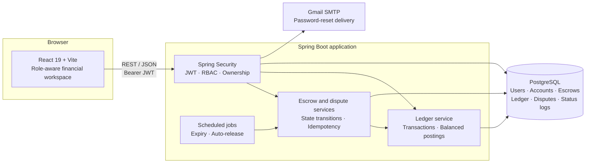
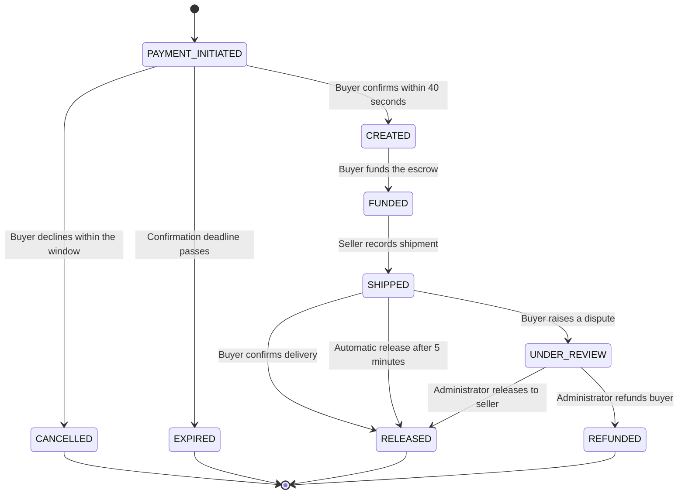

<div align="center">
  
  <h1>RevertPay</h1>
  <p><strong>Money moves. Proof stays.</strong></p>
  <p>
    A full-stack escrow and ledger workspace for protected payments,<br />
    buyer–seller coordination, dispute resolution, and auditable financial records.
  </p>
  <p>
    <a href="https://www.oracle.com/java/"></a>
    <a href="https://spring.io/projects/spring-boot"></a>
    <a href="https://react.dev/"></a>
    <a href="https://www.postgresql.org/"></a>
    <a href="#backend-test-inventory"></a>
    <a href="#frontend-quality-checks"></a>
  </p>
</div>

> [!IMPORTANT]
> RevertPay is an educational full-stack project. It models escrow workflows and internal ledger movements; it is **not connected to banks, card networks, or a live payment gateway**. The current timings and demo-funding behavior are intended for development and demonstration, not production finance.

## Table of contents

- [Overview](#overview)
- [Feature highlights](#feature-highlights)
- [Architecture](#architecture)
- [Escrow lifecycle](#escrow-lifecycle)
- [Roles and permissions](#roles-and-permissions)
- [Security design](#security-design)
- [Frontend experience](#frontend-experience)
- [Getting started](#getting-started)
- [Core API surface](#core-api-surface)
- [Testing and financial invariants](#testing-and-financial-invariants)
- [Project structure](#project-structure)
- [Production hardening](#production-hardening)

## Overview

RevertPay coordinates the complete life of a protected payment: a buyer initiates and confirms a transaction, funds an escrow holding account, a seller records shipment, and the funds are subsequently released to the seller or returned to the buyer after dispute review.

The project goes beyond a CRUD dashboard. Its core engineering concerns are:

- **Atomicity** — a failed financial operation must not leave partial ledger records.
- **Concurrency safety** — competing release attempts must not duplicate money movement.
- **State integrity** — only explicitly supported escrow transitions are allowed.
- **Idempotency** — retrying an initiation request must not create a second escrow.
- **Authorization** — roles and resource ownership are enforced on the server.
- **Auditability** — ledger movements and escrow status transitions can be inspected together.

## Feature highlights

### Financial and escrow core

- Paired debit and credit postings for every successful transfer.
- Balances calculated from ledger entries rather than a mutable account-balance field.
- Positive-amount, distinct-account, and available-balance validation.
- Pessimistic escrow locks for release-sensitive operations.
- Account locks acquired in ascending ID order to reduce deadlock risk.
- Unique idempotency keys with SHA-256 request fingerprints and conflict detection.
- Automatic confirmation expiry and shipment auto-release.
- Buyer disputes, seller responses, and administrator release/refund decisions.
- Status-history records with actor ID, reason, and timestamp.

### User and administration workflows

- Registration and login for `BUYER`, `SELLER`, and `ADMIN` roles.
- Buyer and seller ledger accounts created during registration.
- System `ESCROW_HOLDING` account ensured at application startup.
- Password recovery with expiring, single-use, hashed reset tokens.
- Buyer/seller account overview and complete ledger history.
- Administrative account lookup, account creation, dispute queue, and holding-account ledger.
- Detailed transaction view combining parties, ledger movements, status history, and dispute information.

### Frontend experience

- Responsive React workspace for desktop, tablet, and mobile.
- Role-aware navigation and server-authorized action visibility.
- Obsidian, emerald, and antique-gold design system with locally served fonts.
- Loading skeletons, stale-data refresh states, empty states, and actionable errors.
- Confirmation dialogs for consequential financial actions.
- Real-data credit/debit visualization.
- Ledger search, type filtering, pagination, CSV export, and transaction details.
- Status-specific escrow timelines that do not invent completed milestones.
- Keyboard-accessible dialogs, visible focus states, and reduced-motion support.

## Architecture



### Technology stack

| Layer | Technology |
|---|---|
| Frontend | React 19, Vite 8, native Fetch, `jwt-decode` |
| UI system | Hand-built CSS design tokens, Manrope, IBM Plex Mono |
| Backend | Java 25, Spring Boot 4.1.1, Spring MVC |
| Persistence | Spring Data JPA, Hibernate, PostgreSQL |
| Security | Spring Security, method security, JJWT, Argon2, legacy BCrypt support |
| Scheduling | Spring `@Scheduled` jobs |
| Mail | Spring Mail with Gmail SMTP |
| Backend tests | JUnit 5, Mockito, Spring Boot integration tests |
| Frontend checks | ESLint, Vite production build, server-render smoke checks |

### Request path

1. The browser authenticates and stores the returned JWT.
2. API requests carry `Authorization: Bearer <token>`.
3. The JWT filter validates the token and loads the current user and role.
4. Controller and service rules check role, ownership, state, and request data.
5. Transactional services update escrow state and ledger records in PostgreSQL.
6. The UI renders only server-returned financial information.

## Escrow lifecycle



### When money moves

| Operation | Ledger effect |
|---|---|
| Initiate, confirm, cancel, or expire | No transfer |
| Fund a confirmed escrow | Buyer account → `ESCROW_HOLDING` |
| Record shipment | No transfer |
| Confirm delivery or auto-release | `ESCROW_HOLDING` → seller account |
| Resolve with release | `ESCROW_HOLDING` → seller account |
| Resolve with refund | `ESCROW_HOLDING` → buyer account |

### Current development timings

| Setting | Current value |
|---|---:|
| Buyer confirmation window | 40 seconds |
| Automatic release after shipment | 5 minutes |
| Scheduler polling interval | 5 seconds |

These values are intentionally short for demonstration and should be externalized before deployment.

## Roles and permissions

| Capability | Buyer | Seller | Admin |
|---|:---:|:---:|:---:|
| Register and authenticate | ✓ | ✓ | ✓ |
| View own account and ledger | ✓ | ✓ | — |
| Initiate and fund an escrow | ✓ | — | — |
| Confirm, cancel, or confirm delivery | Own escrows | — | — |
| Record shipment | — | Assigned escrows | — |
| Raise a dispute | Own shipped escrows | — | — |
| Respond to a dispute | — | Assigned disputes | — |
| Review and resolve disputes | — | — | ✓ |
| View holding-account ledger | — | — | ✓ |
| Account lookup and creation UI | — | — | ✓ |

The interface uses roles to present the appropriate workspace, but **frontend visibility is not treated as an authorization boundary**. Sensitive operations also have server-side role and/or ownership checks.

## Security design

### Authentication and passwords

- Stateless JWT authentication with a one-hour token expiration.
- Tokens contain the user ID, email, and role; the current user is loaded from the database.
- Argon2 is the default password encoder.
- Existing BCrypt hashes remain supported and are upgraded to Argon2 after successful login.
- Password fields are excluded from user JSON responses.

### Password recovery

- Cryptographically secure 32-byte random reset tokens.
- Only a SHA-256 hash of each reset token is persisted.
- Reset links expire after 15 minutes.
- Used tokens and older unused tokens are invalidated.
- Forgot-password responses avoid revealing whether an email is registered.

### Financial request protection

- Escrow initiation requires an `Idempotency-Key` header.
- Replaying the same key and request returns the existing escrow response.
- Reusing the key with different request data produces a conflict.
- Release-sensitive paths re-check status after acquiring a row lock.
- Transfer validation happens before debit and credit postings.

## Frontend experience

The active frontend uses a state-based application shell rather than a separate routing framework. JWT-derived roles determine the available workspace, while existing REST contracts remain centralized in `frontend/src/services/api.js`.

Key implementation details:

- Local font assets; no third-party font CDN is required.
- Shared request lifecycle hooks protect against stale responses and duplicate submissions.
- Dialogs provide focus trapping, Escape dismissal, focus restoration, and busy-state close prevention.
- Ledger exports contain the currently filtered, server-returned entries.
- Admin chart totals use holding-ledger aggregates when supplied by the API; account charts derive totals from returned ledger entries.
- The development server proxies `/api` to the backend, keeping browser requests same-origin.

## Getting started

### Prerequisites

| Tool | Requirement |
|---|---|
| Java | **Java 25** |
| Node.js | **Node.js 22.12+** and npm |
| Database | A reachable **PostgreSQL** database |
| Mail | Gmail address and **app password** for password-reset email |
| Maven | Not required separately; the repository includes `mvnw` |

### 1. Clone the repository

```bash
git clone https://github.com/Siva2583/Revert-Pay-2.0.git
cd Revert-Pay-2.0
```

### 2. Configure environment variables

```bash
cp .env.example .env
```

Edit `.env` and also add the two mail variables required by the current configuration:

```dotenv
DB_URL=jdbc:postgresql://localhost:5432/revertpay
DB_USERNAME=your_database_user
DB_PASSWORD=your_database_password

JWT_SECRET=replace_with_a_long_random_secret
APP_USERNAME=revertpay
APP_PASSWORD=replace_with_an_application_password

MAIL_USERNAME=your_address@gmail.com
MAIL_APP_PASSWORD=your_gmail_app_password
```

Use a strong JWT secret, for example:

```bash
openssl rand -hex 32
```

| Variable | Purpose |
|---|---|
| `DB_URL` | PostgreSQL JDBC connection URL |
| `DB_USERNAME` | Database user |
| `DB_PASSWORD` | Database password |
| `JWT_SECRET` | HMAC key used to sign and verify JWTs |
| `APP_USERNAME` | Spring Security application username setting |
| `APP_PASSWORD` | Spring Security application password setting |
| `MAIL_USERNAME` | Gmail account used for reset email |
| `MAIL_APP_PASSWORD` | Gmail app password—not the normal account password |

Never commit `.env` or production credentials. The repository ignores local environment and credential-bearing configuration files.

### 3. Create and configure the database

Create an empty development database matching `DB_URL`, for example `revertpay`. The current application uses Hibernate `ddl-auto=update` to create and evolve the schema.

At startup, the backend ensures that the `ESCROW_HOLDING` account exists.

> [!NOTE]
> **Demo funding:** the current registration path attempts to credit ₹5,000 from `ESCROW_HOLDING` to each newly created `USER` ledger account. A fresh development database therefore needs an appropriate demo opening balance if you want to use that behavior. Replace this demo-issuance approach with an explicit seed or onboarding flow before production.

### 4. Start the backend

From the repository root, load the environment and use the Maven wrapper:

```bash
set -a
source .env
set +a

./mvnw -f backend/pom.xml spring-boot:run
```

The API listens on **http://localhost:8080** by default.

### 5. Start the frontend

In a second terminal:

```bash
cd frontend
npm ci
npm run dev
```

Open **http://localhost:5173**. Vite proxies `/api` requests to `http://localhost:8080`.

Register through the interface and choose the role you want to demonstrate. Buyer and seller registration also creates the corresponding ledger account; the admin workspace does not require a personal ledger account.

### Production builds

```bash
# Backend executable JAR; environment variables must still be supplied
./mvnw -f backend/pom.xml clean package
java -jar backend/target/demo-0.0.1-SNAPSHOT.jar

# Frontend static assets in frontend/dist
cd frontend
npm ci
npm run build
```

A deployed frontend also needs a production API proxy or an updated CORS and API-host configuration.

## Core API surface

All endpoints are prefixed with `/api`. Unless marked public, include the bearer token returned by `/api/auth/login`.

| Method and path | Effective access | Purpose |
|---|---|---|
| `POST /auth/register` | Public | Register a user and role |
| `POST /auth/login` | Public | Authenticate and receive a JWT |
| `POST /auth/forgot-password` | Public | Request password recovery |
| `POST /auth/reset-password` | Public | Consume a reset token |
| `GET /me` | Authenticated buyer/seller | Profile, account, balance, and ledger |
| `GET /accounts/{accountNumber}` | Authenticated | Account lookup |
| `GET /accounts/{accountNumber}/balance` | Authenticated | Ledger-derived balance |
| `GET /accounts/{accountNumber}/ledger` | Authenticated | Account entries |
| `POST /accounts/new` | Authenticated | Create an account record |
| `POST /escrow/initiate` | Buyer | Initiate with an idempotency key |
| `POST /escrow/{id}/confirm` | Owning buyer | Confirm within the deadline |
| `POST /escrow/{id}/cancel` | Owning buyer | Cancel within the deadline |
| `POST /escrow/{id}/fund` | Owning buyer | Fund a confirmed escrow |
| `GET /escrow/buyer` | Buyer | List the current buyer's escrows |
| `GET /escrow/seller` | Seller | List the current seller's escrows |
| `POST /escrow/{id}/ship` | Owning seller | Record shipment |
| `POST /escrow/{id}/confirm-delivery` | Owning buyer | Release a shipped escrow |
| `POST /escrow/{id}/dispute` | Owning buyer | Raise a dispute |
| `GET /escrow/{id}/dispute` | Admin or involved party | Read dispute details |
| `POST /escrow/{disputeId}/respond` | Involved seller | Submit a seller response |
| `POST /escrow/{disputeId}/resolve` | Admin | Release or refund |
| `GET /escrow/admin` | Admin | List escrows under review |
| `GET /admin/ledger/holding` | Admin | Holding-account totals and recent entries |
| `GET /escrow/{id}/ledger-details` | Admin or involved party | Transaction, ledger, timeline, and dispute details |

Escrow initiation additionally requires:

```http
Idempotency-Key: a-unique-client-generated-value
Content-Type: application/json
```

## Testing and financial invariants

### Backend test inventory

The active backend suite contains **22 tests across seven active test classes**, covering **26 documented ledger, concurrency, scheduler, and lifecycle behaviors**. The 26 behaviors are distributed across 22 test methods because some tests verify multiple related invariants.

| Test class | Tests | What it verifies |
|---|---:|---|
| `LedgerServiceRollbackTest` | 1 | Debit and credit entries roll back when the surrounding transaction fails |
| `LedgerIntegrityTest` | 1 | Exactly one debit and one credit, matching amounts, and correct accounts |
| `EscrowConcurrentReleaseTest` | 1 | 50 coordinated attempts produce one success, `RELEASED`, and exactly two postings |
| `EscrowAutoReleaseConcurrencyTest` | 1 | Buyer confirmation racing automatic release cannot duplicate payment |
| `EscrowAutoReleaseTest` | 4 | Overdue release, future-deadline protection, repeated release, and missing deadlines |
| `EscrowSchedulerTest` | 3 | Overdue detection, no-op when clear, and failure isolation between escrows |
| `EscrowConfirmationFlowTest` | 11 | Confirmation, cancellation, funding, ownership, expiry, and no-transfer rejection paths |
| **Total** | **22** | **26 documented behaviors** |

The suite combines Spring Boot integration tests with focused Mockito tests. Fully commented-out legacy repository test files are not included in this count.

<details>
<summary><strong>View the 26-behavior coverage map</strong></summary>

| # | Covered behavior | Active test class |
|---:|---|---|
| 1 | A transfer creates one debit and one credit | `LedgerIntegrityTest` |
| 2 | Debit and credit amounts match | `LedgerIntegrityTest` |
| 3 | Sender is debited and receiver is credited | `LedgerIntegrityTest` |
| 4 | No ledger records remain after transaction failure | `LedgerServiceRollbackTest` |
| 5 | Only one concurrent release attempt succeeds | `EscrowConcurrentReleaseTest` |
| 6 | Concurrent release produces exactly two ledger entries | `EscrowConcurrentReleaseTest` |
| 7 | Concurrent release finishes in `RELEASED` state | `EscrowConcurrentReleaseTest` |
| 8 | Manual and automatic release can race safely | `EscrowAutoReleaseConcurrencyTest` |
| 9 | A manual/automatic race produces one financial release | `EscrowAutoReleaseConcurrencyTest` |
| 10 | Shipped escrows auto-release after the deadline | `EscrowAutoReleaseTest` |
| 11 | Auto-release does not run before the deadline | `EscrowAutoReleaseTest` |
| 12 | Already released escrows are not released again | `EscrowAutoReleaseTest` |
| 13 | Missing auto-release deadlines are handled safely | `EscrowAutoReleaseTest` |
| 14 | The scheduler finds expired transactions | `EscrowSchedulerTest` |
| 15 | The scheduler performs no work when none are expired | `EscrowSchedulerTest` |
| 16 | One scheduler failure does not stop later transactions | `EscrowSchedulerTest` |
| 17 | Buyer delivery confirmation releases escrow funds | `EscrowConfirmationFlowTest` |
| 18 | A non-buyer cannot confirm delivery | `EscrowConfirmationFlowTest` |
| 19 | Delivery confirmation requires `SHIPPED` state | `EscrowConfirmationFlowTest` |
| 20 | Buyer confirmation succeeds within 40 seconds | `EscrowConfirmationFlowTest` |
| 21 | Buyer confirmation is rejected after 40 seconds | `EscrowConfirmationFlowTest` |
| 22 | Confirmation requires `PAYMENT_INITIATED` state | `EscrowConfirmationFlowTest` |
| 23 | Buyer cancellation succeeds within 40 seconds | `EscrowConfirmationFlowTest` |
| 24 | Buyer cancellation is rejected after 40 seconds | `EscrowConfirmationFlowTest` |
| 25 | Funding is allowed only for `CREATED` escrows | `EscrowConfirmationFlowTest` |
| 26 | A different buyer cannot fund the escrow | `EscrowConfirmationFlowTest` |

</details>

### Why these tests matter

**Atomicity** is tested by deliberately failing after a transfer and checking that no partial ledger postings remain.

**Duplicate-release protection** is tested with real thread pools and countdown latches, not a sequential loop. The assertions inspect final state and exact ledger counts.

**Temporal correctness** is tested around confirmation deadlines, shipment auto-release deadlines, missing deadlines, and already-confirmed transactions.

**Workflow correctness** is tested by checking both the resulting status and whether the ledger service was invoked.

### Run backend tests

> [!WARNING]
> Several `@SpringBootTest` tests use the configured database and create test records. Run them against a **disposable development/test database**, never production.

```bash
set -a
source .env
set +a

./mvnw -f backend/pom.xml test
```

Run focused non-database unit suites with:

```bash
./mvnw -f backend/pom.xml \
  -Dtest=EscrowConfirmationFlowTest,EscrowSchedulerTest test
```

### Frontend quality checks

```bash
cd frontend
npm ci
npm run lint
npm run test:render
npm run build
```

- `lint` checks the frontend source with ESLint.
- `test:render` runs **22 server-render smoke checks** covering active components, populated ledger states, artwork preservation, and escrow lifecycle variants.
- `build` produces the optimized Vite bundle in `frontend/dist`.

Render smoke checks complement—but do not replace—the backend suite or live end-to-end testing.

## Project structure

```text
Revert-Pay-2.0/
├── backend/
│   ├── pom.xml
│   └── src/
│       ├── main/
│       │   ├── java/com/revertpay/
│       │   │   ├── account/       # Accounts and ownership types
│       │   │   ├── config/        # Security and CORS configuration
│       │   │   ├── dispute/       # Dispute responses and resolution
│       │   │   ├── dto/           # API request/response models
│       │   │   ├── escrow/        # State machine, locking, expiry, audit details
│       │   │   ├── exception/     # REST error handling
│       │   │   ├── ledger/        # Balanced postings and derived balances
│       │   │   ├── security/      # JWT filter and ownership checks
│       │   │   └── user/          # Authentication and password recovery
│       │   └── resources/application.properties
│       └── test/java/com/revertpay/
├── frontend/
│   ├── scripts/render-smoke.mjs
│   ├── src/
│   │   ├── assets/               # Artwork and image assets bundled by Vite
│   │   ├── components/           # Screens and shared UI primitives
│   │   ├── hooks/                # Request and async-action lifecycle
│   │   ├── services/             # API registry and Fetch wrapper
│   │   ├── styles/               # Editorial and workspace layers
│   │   └── utils/                # Role, navigation, escrow, and formatting helpers
│   └── package.json
├── .env.example
├── mvnw
└── README.md
```

## Production hardening

RevertPay already demonstrates meaningful financial invariants. Before treating it as a deployable production system, the next priorities are:

1. **Replace schema auto-update with migrations** using Flyway or Liquibase.
2. **Isolate integration tests** with a dedicated test database or Testcontainers and repeatable cleanup.
3. **Review provisioning rules** for administrative registration and align account-endpoint authorization with the intended role model.
4. **Replace demo behavior** such as automatic demo credits and development/test controllers with explicit environment-specific flows.
5. **Externalize configuration** for CORS origins, reset links, scheduler timings, and API hosts.
6. **Harden web security** with rate limiting, secret rotation, secure deployment headers, and a deliberate review of browser token storage.
7. **Add operational observability** for scheduler failures, retries, structured logs, and alerting.
8. **Add CI and dependency remediation** so backend tests, frontend checks, builds, and security updates run on every change.
9. **Paginate large datasets on the server** as ledger and escrow history grows.

---

<div align="center">
  <strong>RevertPay · Protected payments, provable records</strong><br />
  Built with Java, Spring Boot, PostgreSQL, and React.<br />
  Maintained by <a href="https://github.com/Siva2583">Siva2583</a>.
</div>
